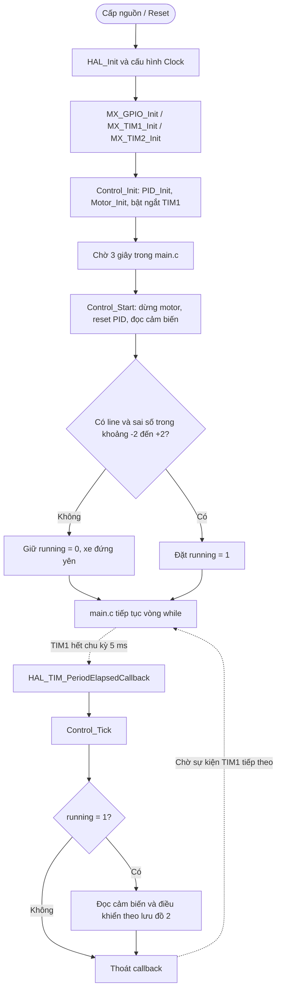
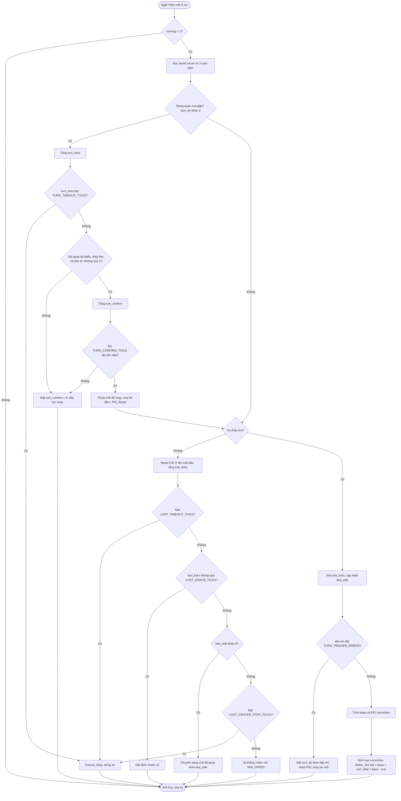

# XE RÒ LINE 4 BÁNH — STM32F103 | PID & CUA GẤP 90°

> Dự án robot 4 bánh dò vạch đen trên nền sáng, sử dụng **STM32F103C8Tx**, **5 cảm biến TCRT5000**, **2 driver TB6612FNG**, điều khiển tốc độ bằng PWM và thuật toán bám line PID kết hợp chế độ xoay tìm vạch ở cua gấp.
>
> **Tác giả:** **Edric0807** — GitHub: [@caoduy600-ux](https://github.com/caoduy600-ux)  
> **Mã nguồn:** [caoduy600-ux/Xe_ro_line](https://github.com/caoduy600-ux/Xe_ro_line)  
> **Tài liệu lưu đồ:** Cập nhật theo mã nguồn trên nhánh `main`, kiểm tra ngày **01/11/2026**.

## 1. Mục tiêu và tính năng

- Bám vạch đen bằng 5 đầu dò số, tính sai số có dấu trong khoảng **−4 đến +4**.
- Điều chỉnh chênh lệch tốc độ hai bên bánh bằng **PID**; giảm tốc độ cơ sở khi lệch line.
- Khi line lệch mạnh, chuyển sang **quay tại chỗ** để xử lý cua gấp, bao gồm góc cua dạng 90° nếu cảm biến nhận được hướng vạch.
- Khi mất line ngắn, giữ lệnh motor gần nhất; mất line lâu hơn thì tìm theo hướng cuối; hết thời gian cho phép thì dừng.
- Điều khiển theo chu kỳ **5 ms (200 Hz)** nhờ ngắt TIM1; PWM motor bằng TIM2.

> **Giới hạn:** Robot hiện không có encoder/IMU để đo góc. “Rẽ 90°” ở đây là **xoay tìm lại vạch** chứ không phải điều khiển quay chính xác một góc 90°. Nếu vạch biến mất khi các cảm biến đang ở giữa và không có thông tin hướng cua, thuật toán không suy ra chắc chắn hướng rẽ.

## 2. Phần cứng và ánh xạ chân

| Thành phần | Cấu hình trong dự án |
|---|---|
| Vi điều khiển | STM32F103C8Tx, lập trình bằng STM32CubeIDE / HAL |
| Cảm biến | 5 × TCRT5000, phát hiện vạch đen khi mức GPIO = `0` (`SENSOR_ACTIVE_LEVEL`) |
| Vị trí cảm biến | **S4 (trái)** ← S3 ← S2 (giữa) → S1 → **S0 (phải)**, theo chiều xe tiến |
| Chân cảm biến | S0: PB12; S1: PB13; S2: PB14; S3: PB15; S4: PA8 |
| Cơ cấu di chuyển | 4 động cơ DC, điều khiển vi sai theo 2 bên trái/phải |
| Driver | 2 × TB6612FNG, chung tín hiệu cho mỗi bên bánh |
| PWM | TIM2_CH1: PA0; TIM2_CH2: PA1; thang lệnh `Motor_Set()` từ −1000 đến +1000 |
| GPIO chọn chiều | Kênh A: PB0 / PB1; kênh B: PB5 / PB8; STBY: PB9 |
| Timer điều khiển | TIM1: PSC=7199, ARR=49 → 5 ms, với clock TIM1 = 72 MHz |
| PWM motor | TIM2: PSC=0, ARR=3599 → xấp xỉ 20 kHz, với clock TIM2 = 72 MHz |

**Quan trọng về đấu nối:** Tên `MOTOR_L_CH` / `MOTOR_R_CH` trong `config.h` là tên kênh logic. Trong quá trình thử thực tế, hai kênh từng bị **đảo so với bên bánh thật**. Hãy bảo đảm phiên bản `motor.c` đang nạp đã sửa ánh xạ đúng: `Motor_Set(350, 0)` chỉ làm bánh **trái** tiến, và `Motor_Set(0, 350)` chỉ làm bánh **phải** tiến. Không đổi dấu PID để chữa lỗi đấu nối ngược.

## 3. Cấu trúc chương trình

```text
Xe_ro_line/
├── Core/
│   ├── Inc/
│   │   ├── config.h       # Chân GPIO, tốc độ, PID và ngưỡng xử lý
│   │   ├── control.h      # Hàm khởi tạo, bắt đầu, dừng
│   │   ├── sensor.h       # API đọc cảm biến
│   │   ├── pid.h          # Kiểu PID_t và API PID
│   │   └── motor.h        # API điều khiển motor
│   └── Src/
│       ├── main.c         # Khởi tạo phần cứng và kích hoạt điều khiển
│       ├── control.c      # Điều phối toàn bộ thuật toán dò line
│       ├── sensor.c       # Tính sai số từ 5 cảm biến
│       ├── pid.c          # Tính hiệu chỉnh P, I, D
│       ├── motor.c        # Chuyển lệnh tốc độ thành GPIO/PWM
│       ├── tim.c          # TIM1 và TIM2
│       └── gpio.c         # Cấu hình GPIO
└── README.md             # Tài liệu này
```

**Luồng xử lý:** `main.c` → TIM1 ngắt → `HAL_TIM_PeriodElapsedCallback()` → `Control_Tick()` → `Sensor_GetError()` → `PID_Compute()` / `Control_Pivot()` → `Motor_Set()` → TB6612FNG → bánh xe.

## 4. Lưu đồ 1 — Khởi động và chu kỳ điều khiển

GitHub hiển thị trực tiếp sơ đồ dưới đây bằng **Mermaid** (không cần cài phần mềm vẽ).



**Lưu ý:** `Control_Start()` trong `main.c` chỉ được gọi **một lần**. Nếu ban đầu không thỏa điều kiện nhìn thấy line gần giữa, xe sẽ không tự thử khởi động lại. Khi xe dừng do timeout, nó cũng không tự khởi động lại.

## 5. Lưu đồ 2 — Thuật toán `Control_Tick()`

Lưu đồ thể hiện **phiên bản trên GitHub có chế độ quay cua gấp (`turn_dir`) và các bộ đếm xác nhận**.



**Bản PNG để chèn báo cáo:** [Xem lưu đồ tổng thể](docs/luu_do_tong_quan.png) · [Xem lưu đồ điều khiển](docs/luu_do_dieu_khien.png).

## 6. Cách tính sai số và PID

### 6.1. Từ cảm biến sang `err`

| Cảm biến bắt được vạch | S4 | S3 | S2 | S1 | S0 |
|---|---:|---:|---:|---:|---:|
| Trọng số | −4 | −2 | 0 | +2 | +4 |

Trong `sensor.c`, khi có nhiều mắt cùng thấy vạch, sai số bằng **trung bình trọng số của các mắt đang thấy line**:

\[
 e = \frac{\sum_i w_i \cdot s_i}{\sum_i s_i}, \qquad s_i \in \{0,1\}
\]

Trong đó `s_i = 1` nghĩa là mắt thứ `i` thấy vạch đen (đã chuyển đổi từ mức GPIO). Khi không mắt nào thấy line, `Sensor_GetError()` trả về `found = 0` và một sai số giả theo `last_error`; **sai số giả không được đưa vào PID**, mà `control.c` xử lý riêng bằng chế độ mất line.

### 6.2. PID và tốc độ hai bên

```c
base = BASE_SPEED - SLOW_GAIN * abs_err;
base = clamp(base, MIN_SPEED, 1000);
corr = PID_Compute(&pid_line, err, CTRL_DT);
corr = clamp(corr, -base, base);
left  = base + corr;
right = base - corr;
Motor_Set(left, right);
```

Trong đó:

- `err > 0`: line ở **bên phải** → `corr` dương (với P dương và D/I phù hợp), bánh **trái** được yêu cầu chạy nhanh hơn bánh phải.
- `err < 0`: line ở **bên trái** → điều chỉnh ngược lại.
- `base` nhỏ dần khi lệch vạch nhiều, giúp giảm tốc trước khi rẽ.
- `pid.c` hỗ trợ thành phần D có bộ lọc; ở cấu hình hiện tại `PID_KD = 0`, nên đang sử dụng **điều khiển P** (I và D đều bằng 0), dù module PID vẫn đầy đủ.

## 7. Chế độ cua gấp và tìm lại line

- **Bám line bình thường:** Khi `|err| < TURN_TRIGGER_ERROR`, dùng PID.
- **Phát hiện cua gấp:** Khi `|err| >= TURN_TRIGGER_ERROR`, đặt `turn_dir` theo dấu sai số và gọi `Control_Pivot()`: rẽ phải `Motor_Set(+TURN_SPEED, -TURN_SPEED)`, rẽ trái theo chiều ngược lại.
- **Đang xoay:** Tiếp tục xoay ít nhất `TURN_MIN_TICKS`, sau đó chỉ thoát khi cảm biến thấy line gần tâm (`|err| <= 1`) đủ `TURN_CONFIRM_TICKS` mẫu liên tiếp.
- **Giới hạn xoay:** Nếu đạt `TURN_TIMEOUT_TICKS` mà chưa thoát, dừng xe.
- **Mất line ngoài chế độ xoay:** Giữ tốc độ cũ trong `LOST_GRACE_TICKS`; nếu có `last_side` thì chuyển sang xoay tìm lại; nếu không biết hướng thì đi thẳng chậm và dừng khi đạt `LOST_CENTER_STOP_TICKS`.

**Điểm cần lưu ý khi đọc code:** `LOST_TIMEOUT_TICKS` áp dụng trong nhánh mất line **trước khi** vào chế độ xoay, còn `TURN_TIMEOUT_TICKS` áp dụng khi đang ở chế độ xoay. Chúng là hai giới hạn khác nhau.

## 8. Thông số đang khai báo trong `config.h`

Các giá trị sau được ghi theo tệp `Core/Inc/config.h` trên nhánh `main` tại thời điểm lập README, không phải khuyến nghị tối ưu tuyệt đối.

| Macro | Giá trị | Ý nghĩa |
|---|---:|---|
| `SENSOR_ACTIVE_LEVEL` | `0` | GPIO mức 0 là phát hiện vạch đen |
| `BASE_SPEED` | `260` | Tốc độ cơ sở thang 0–1000 |
| `MIN_SPEED` | `210` | Ngưỡng dưới của tốc độ cơ sở |
| `SLOW_GAIN` | `15.0f` | Giảm tốc khi tăng độ lệch |
| `PID_KP` | `50.0f` | Hệ số P |
| `PID_KI` | `0.0f` | Hệ số I, đang tắt |
| `PID_KD` | `0.0f` | Hệ số D, đang tắt |
| `CTRL_DT` | `0.005f` | Chu kỳ PID = 5 ms |
| `LOST_GRACE_TICKS` | `2U` | Giữ lệnh cũ trong 10 ms khi mất line |
| `LOST_CENTER_STOP_TICKS` | `25U` | Không biết hướng: dừng sau 125 ms |
| `LOST_TIMEOUT_TICKS` | `100U` | Giới hạn nhánh mất line: 500 ms |
| `TURN_SPEED` | `350` | PWM xoay tại chỗ |
| `TURN_TRIGGER_ERROR` | `3.0f` | Ngưỡng phát hiện cua gấp |
| `TURN_MIN_TICKS` | `8U` | Quay tối thiểu 40 ms |
| `TURN_CONFIRM_TICKS` | `3U` | Cần 3 mẫu gần tâm liên tiếp (15 ms) |
| `TURN_TIMEOUT_TICKS` | `160U` | Dừng nếu quay quá 800 ms |

Các hằng `LOST_ERROR`, `RECOVER_SPEED`, `START_DELAY_MS` cũng có trong `config.h`; không phải tất cả đều được dùng trực tiếp trong đường điều khiển hiện tại. `main.c` hiện gọi `HAL_Delay(3000)` trực tiếp.

## 9. Hướng dẫn build và chạy

1. Clone dự án: `git clone https://github.com/caoduy600-ux/Xe_ro_line.git`.
2. Mở STM32CubeIDE → **File → Import → Existing Projects into Workspace** → chọn thư mục dự án.
3. Kiểm tra các đường nối GPIO, nguồn motor và GND chung; kê xe để bánh **không chạm sàn** ở lần chạy đầu.
4. **Build Project**, kết nối ST-LINK và nạp firmware vào STM32.
5. Kiểm tra độc lập: `Motor_Set(350, 0)` phải làm bên trái tiến; `Motor_Set(0, 350)` phải làm bên phải tiến. Nếu không, sửa ánh xạ motor **trước khi** chạy thuật toán dò line.
6. Khôi phục `main.c` về `Control_Init()` → chờ 3 giây → `Control_Start()`. Đặt line gần S2 khi khởi động.
7. Thử lần lượt đường thẳng → cua cong → cua gấp, bắt đầu ở tốc độ thấp và có khả năng ngắt nguồn ngay.

### Khắc phục sự cố

| Hiện tượng | Kiểm tra trước tiên |
|---|---|
| Xe không xuất phát | S2 có thấy vạch? `Control_Start()` yêu cầu `found=1` và `err` trong [−2, +2] |
| Line bên phải nhưng xe rẽ trái | Xác nhận thứ tự S0/S4 và **ánh xạ trái/phải trong `Motor_Set()`** |
| Xe giật khi đổi mắt cảm biến | `LOST_GRACE_TICKS`, mức ngưỡng, độ cao đầu dò, nhiễu ngõ vào cảm biến |
| Cua 90° bị quá đà | Giảm `TURN_SPEED`, xem `TURN_MIN_TICKS` và `TURN_CONFIRM_TICKS` |
| Xoay mãi không bắt được line | Kiểm tra hướng `last_side`, bề rộng vạch, vị trí cụm cảm biến và ngưỡng timeout |
| Không bám được cua vuông khi line biến mất từ giữa | Không đủ thông tin hướng rẽ; cần bổ sung quy tắc đường chạy hoặc mốc/encoder/IMU |

## 10. Giới hạn và hướng phát triển

- Hiệu chỉnh tốc độ với encoder để hai bên bánh quay đồng đều hơn.
- Sử dụng IMU/encoder nếu cần quay **đúng góc 90°** thay vì chỉ tìm lại line.
- Xử lý đường giao nhau, vạch đứt, nhánh rẽ trái/phải theo quy tắc cuộc thi.
- Kiểm tra chống nhiễu và hiệu chỉnh độ cao của dãy TCRT5000.
- Tinh chỉnh `Kp`, `Kd`, tốc độ quay từ dữ liệu thử nghiệm thực tế, từng thông số một.

## 11. Cập nhật README lên GitHub

Đặt `README.md` ở **thư mục gốc repository** (cùng cấp `Core/`, `Drivers/`). Đặt thư mục `docs/` cạnh README nếu muốn hiển thị liên kết tới hai sơ đồ PNG.

```bash
git status
git add README.md docs/luu_do_tong_quan.png docs/luu_do_dieu_khien.png
git commit -m "docs: add README and line-following flowcharts"
git push origin main
```

Sau khi push, GitHub sẽ hiển thị README và **tự render hai lưu đồ Mermaid** ngay trên trang chủ repository.

---

**Tác giả / Author:** [Edric0807 (@caoduy600-ux)](https://github.com/caoduy600-ux)  
**Dự án:** [Xe_ro_line](https://github.com/caoduy600-ux/Xe_ro_line)
